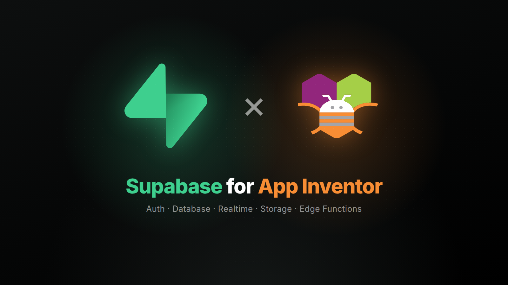
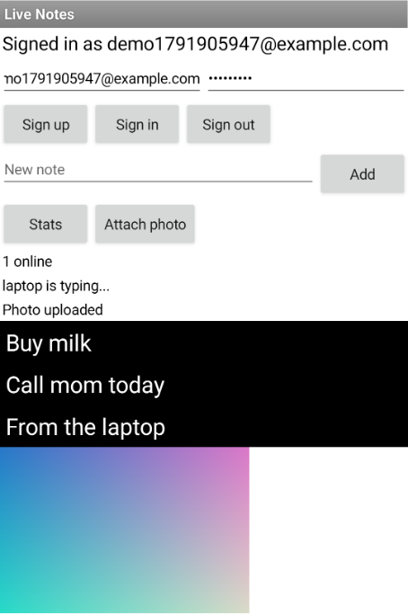

<p align="center">
  
</p>

<p align="center">
  <a href="https://github.com/zainulhassan815/supabase-appinventor/releases/latest"></a>
  <a href="LICENSE"></a>
  
  
</p>

<p align="center">
  <a href="https://github.com/zainulhassan815/supabase-appinventor/releases/latest">Download</a> ·
  <a href="docs/getting-started.md">Getting started</a> ·
  <a href="docs">Guides</a> ·
  <a href="docs/blocks.md">Blocks</a> ·
  <a href="ROADMAP.md">Roadmap</a>
</p>

A [Supabase](https://supabase.com) extension for MIT App Inventor and App Inventor based
platforms. It gives your apps a real backend, with a generous free plan: user accounts,
a Postgres database protected by row-level security, live updates on every phone, file
storage and server code. All from blocks, and it works in the AI Companion.

## Features

- **Accounts:** sign up and sign in with email and password, with a code sent by email or
  text message, or anonymously; reset forgotten passwords. Users stay signed in between
  app starts. Change the email, password or profile, and turn an
  anonymous user into a full account.
- **Database:** queries as dictionaries with dropdown keys, checked before they're sent:
  filters with any, all and not, ordering by several columns, pages with a total count. Insert, upsert, insert
  or skip, update and delete; call your own database functions; use other schemas.
- **Realtime:** react the moment a row is added, changed or deleted, send messages
  between users, and see who is online, on channels only your users can join.
- **Storage:** upload media files, picker and camera results or any file; download,
  list, search, move, copy and delete; read file details; make temporary links to
  private files, and upload links for others.
- **Edge Functions:** call your own server code, for work an app can't do safely, such
  as calling a paid API with a secret key, in any region.
- **Safe by default:** only publishable keys are accepted, and every request runs as
  the signed-in user, so row-level security applies.

## Quick start

1. Create a free project at [supabase.com](https://supabase.com).
2. Open the **SQL Editor** and create your tables. To try the sample app, run
   [`schema.sql`](samples/live-notes/schema.sql).
3. Download `dev.dreamerslab.supabase.aix` from the
   [latest release](https://github.com/zainulhassan815/supabase-appinventor/releases/latest)
   and import it (Palette → Extension → Import extension).
4. Add a **Supabase** component and set `ProjectUrl` and `PublishableKey`. Both are in
   your project's settings (Project Settings → API Keys).
5. Add the other components you need and set their `Client` property to `Supabase1`.

The [getting started guide](docs/getting-started.md) builds a complete to-do app step by
step.

## How results arrive

Calls to Supabase take time, so their results arrive in **events**, like `Web.GotText`,
never as the value of the block that started them.

- Sign-in blocks answer through `Supabase.SessionChanged`, which also fires when the app
  starts with a saved session.
- Data blocks take a **tag**, any text you choose, and their result event carries it
  back: `Query("todos", …)` answers with `GotRows("todos", rows)`. One event handler
  can tell all your requests apart.
- Failures fire the component's `Error` event with a short code, such as
  `invalid_credentials`, and a readable message. See [Errors](docs/errors.md).

Rows, users and messages are dictionaries, and lists of rows are lists of dictionaries,
so the dictionary and list blocks you already know work on them directly.

## Sample app



`LiveNotes.aia` in every release is a complete app that uses all five components:

- sign up, sign in and sign out;
- a notes list that updates live on every phone;
- tap a note to delete it;
- see who is online and who is typing;
- count notes and words with an Edge Function;
- upload a photo and show it through a signed link.

Run [`schema.sql`](samples/live-notes/schema.sql) in your project, import the `.aia`,
and set `ProjectUrl` and `PublishableKey` on `Supabase1`. For the stats button, deploy
the [`note-stats`](supabase/functions/note-stats/index.ts) function with
`supabase functions deploy note-stats --project-ref <project-ref>`.

<br clear="right">

## Components

| Component | What it does | Guide |
|---|---|---|
| **Supabase** | Connects to a project and signs users in and out. Keeps the session between app starts. | [Authentication](docs/authentication.md) |
| **SupabaseDatabase** | Queries, counts, inserts, upserts, updates and deletes rows, and calls database functions. | [Database](docs/database.md) |
| **SupabaseStorage** | Uploads, downloads, lists, searches, moves, copies and deletes files in a bucket, and makes links to them. | [Storage](docs/storage.md) |
| **SupabaseChannel** | Receives database changes as they happen, and sends messages and online status between users. | [Realtime](docs/realtime.md) |
| **SupabaseFunctions** | Calls Edge Functions, your own server code. | [Edge Functions](docs/functions.md) |

Every block is shown with its description in [Blocks](docs/blocks.md). Each image
contains its block: drag it into your workspace.

## Security

- Use the **publishable** key (`sb_publishable_…`, or the legacy `anon` key). The
  extension refuses secret and `service_role` keys on purpose: anything inside an app
  can be extracted, and those keys bypass every rule.
- Turn on **row-level security** for every table and write policies for what each user
  may read and change. The publishable key alone should reveal nothing. The sample's
  [`schema.sql`](samples/live-notes/schema.sql) shows owner-only policies for a table
  and a storage bucket.
- Make realtime channels **private** when their broadcasts or presence aren't for
  everyone: anyone with the publishable key can join a public channel. Policies on
  `realtime.messages` decide who joins a private one. See
  [Private channels](docs/realtime.md#private-channels).
- The session is saved in the app's private storage, like TinyDB. It isn't encrypted.

## FAQ

**Does it work in the AI Companion?** Yes. Live testing in the Companion, compiled apps
and installed apps all work, and the session survives restarts.

**Which devices?** Android 7.0 and newer.

**Kodular and other builders?** The extension ships no AARs and adds nothing to the
manifest, so it should work on App Inventor based builders, but so far only MIT App
Inventor has been tested. Reports are welcome.

**I signed up, but nobody is signed in.** New projects require email confirmation:
`SignedUp` fires, and the user is signed in after clicking the link in the email. Turn
off **Confirm email** (Authentication → Sign In / Providers → Email) while testing.

**`SessionChanged` fired with `SignedIn` more than once.** It fires whenever the session
changes, which includes refreshing it. Guard one-time setup, such as subscribing to a
channel, with a variable.

**`oldRecord` only has the id.** Postgres only sends the old row's primary key unless
you run `alter table <name> replica identity full;`.

**Can I sign in with Google, GitHub or a magic link?** Not yet. Browser-based sign-in is
planned for v1.3; see the [roadmap](ROADMAP.md).

## Building

```
rush build
python3 samples/package.py
```

`rush build` writes the extension to `out/dev.dreamerslab.supabase.aix` with its block
reference, and `samples/package.py` packs the sample into `out/LiveNotes.aia`. After
changing blocks, render their images into `docs/images/blocks` (see
[Testing](docs/testing.md)) and regenerate [docs/blocks.md](docs/blocks.md) with
`python3 docs/blocks.py`; it fails if a block has no image. GitHub
Actions builds both on every push, and a tag named after the version in `rush.yml`, like
`v1.0.0`, publishes a release.

The tests build real App Inventor apps with App Inventor's build server and run them on
a device against a local Supabase. See [Testing](docs/testing.md).

## License

[MPL-2.0](LICENSE). Use the extension in any app, free or commercial, and keep your
app's code to yourself. If you change the extension's own files and distribute them,
share those changes under the same license.

Built with [Rush](https://github.com/shreyashsaitwal/rush-cli) on
[supabase-kt](https://github.com/supabase-community/supabase-kt). Supabase and MIT App
Inventor are trademarks of their owners; this is a community project, not an official
one.
