# Blocks

Every block of the Supabase extension. Each image contains its block, so you can drag it straight into your workspace.

- [Supabase](#supabase)
- [SupabaseDatabase](#supabasedatabase)
- [SupabaseStorage](#supabasestorage)
- [SupabaseChannel](#supabasechannel)
- [SupabaseFunctions](#supabasefunctions)
- [Dropdowns](#dropdowns)
- [Deprecated](#deprecated)

## Supabase

Connects the app to a Supabase project and signs users in. Other Supabase components use it through their Client property. Guide: [Authentication](authentication.md).

### Supabase: Functions

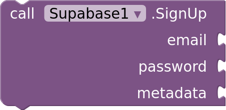

**SignUp:** Creates an account with an email and password. Metadata is a dictionary saved with the user. SignedUp fires with the new user; when the project doesn't require email confirmation, the user is also signed in and SessionChanged fires.

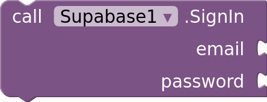

**SignIn:** Signs in with an email and password. SessionChanged fires when it succeeds.

**SignInAnonymously:** Signs in as a new anonymous user. Anonymous sign-ins must be enabled in the project. SessionChanged fires when it succeeds.

**SignOut:** Signs the user out and forgets the saved session. SessionChanged fires.

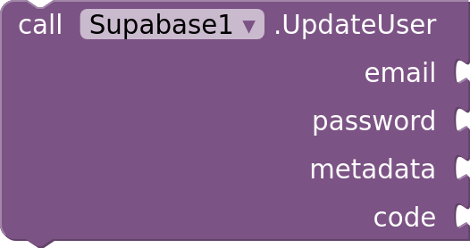

**UpdateUser:** Changes the signed-in user. Leave email or password empty, or metadata an empty dictionary, to keep them; metadata is merged into the saved metadata. A new email must be confirmed through the link sent to it before it is used. Code is the code sent by Reauthenticate, needed for a new password when the project turns on Secure password change; otherwise leave it empty. Giving an anonymous user an email and then a password makes it a full account. UserUpdated fires.

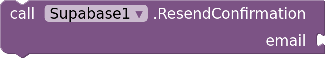

**ResendConfirmation:** Sends the sign-up confirmation email again. MessageSent fires.

**Reauthenticate:** Sends the signed-in user a code by email, or by text message for a phone account, to confirm a password change with UpdateUser. MessageSent fires.

### Supabase: Events

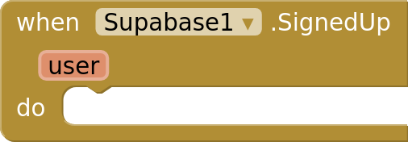

**SignedUp:** An account was created by SignUp.

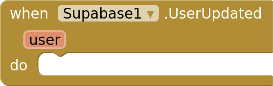

**UserUpdated:** UpdateUser changed the user.

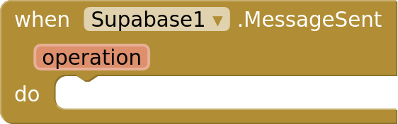

**MessageSent:** An email or text message was sent. Operation is the block that sent it, such as Reauthenticate.

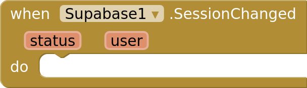

**SessionChanged:** The user signed in or out, or a saved session was restored when the app started.

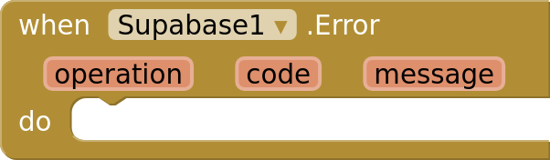

**Error:** A Supabase call failed. Code is Supabase's error code, such as invalid_credentials, or network when Supabase couldn't be reached. Without this event, Screen.ErrorOccurred fires instead.

### Supabase: Properties

 

**ProjectUrl** (read-write): The project URL, for example https://abcd.supabase.co.

 

**PublishableKey** (read-write): The project's publishable (anon) key. Never use a secret or service_role key.

**IsSignedIn** (read-only): Whether a user is signed in.

**CurrentUser** (read-only): The signed-in user as a dictionary, or an empty dictionary.

**AccessToken** (read-only): The signed-in user's access token, for calling your own servers. Empty when signed out.

## SupabaseDatabase

Reads and writes the tables of a Supabase project, and calls its database functions. Row-level security decides what the signed-in user may see and change. Guide: [Database](database.md).

### SupabaseDatabase: Functions

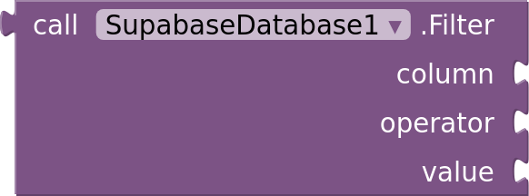

**Filter:** Makes a filter for Query, Count, Update and Delete. For In, Contains, ContainedBy and Overlaps, the value is a list.

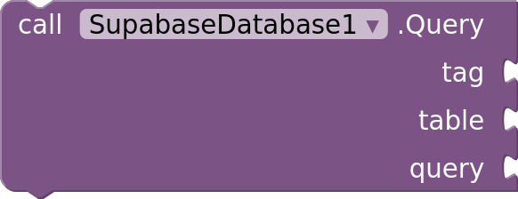

**Query:** Reads the rows of a table that match the query. Query is a dictionary with QueryField keys, all optional: an empty dictionary reads every row. GotRows fires with the tag and the rows, as a list of dictionaries.

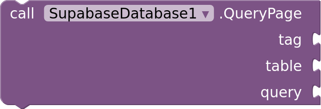

**QueryPage:** Reads one page of rows like Query, and counts every row that matches the filters, for paging. GotPage fires with the rows and the total.

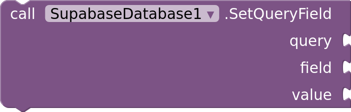

**SetQueryField:** Sets one setting of a query for Query and QueryPage, and checks its value.

**Count:** Counts the rows of a table that match every filter. GotCount fires with the tag and the count.

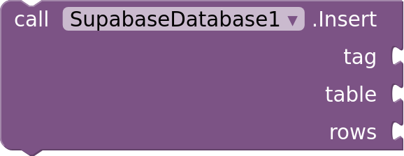

**Insert:** Adds rows to a table. Rows is a dictionary, or a list of dictionaries. GotRows fires with the added rows, including the values the database filled in.

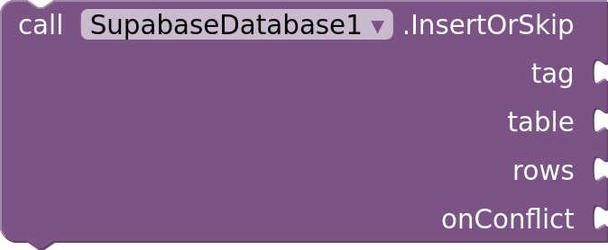

**InsertOrSkip:** Adds rows, skipping the rows that already exist. OnConflict works like in Upsert. GotRows fires with the rows that were added.

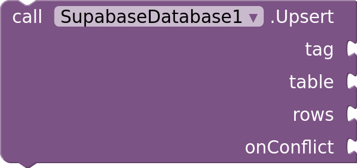

**Upsert:** Adds rows, or updates the rows that already exist. OnConflict lists the unique columns that identify a row, comma-separated; leave it empty to use the primary key. GotRows fires with the rows.

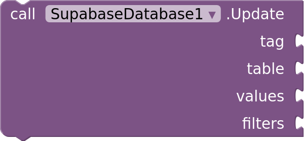

**Update:** Changes columns of every row that matches the filters. Values is a dictionary of column names and new values. GotRows fires with the changed rows.

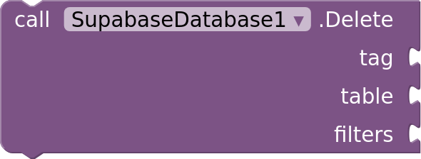

**Delete:** Deletes every row that matches the filters. GotRows fires with the deleted rows.

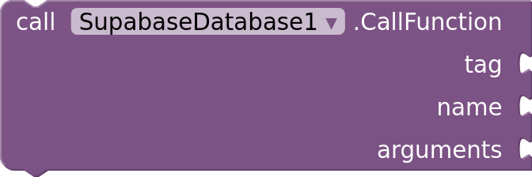

**CallFunction:** Calls a database function (RPC) with a dictionary of arguments. GotResult fires with its result: a list, a dictionary, or a single value.

### SupabaseDatabase: Events

**GotRows:** Rows arrived from Query, Insert, Upsert, Update or Delete.

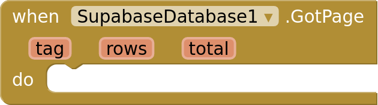

**GotPage:** A page of rows arrived from QueryPage. Total is how many rows match the filters.

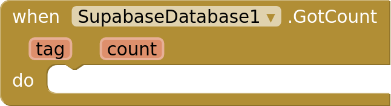

**GotCount:** A count arrived from Count.

**GotResult:** A database function called with CallFunction returned.

**Error:** A database call failed. Code is the PostgREST or Postgres error code, or network. Without this event, Screen.ErrorOccurred fires instead.

### SupabaseDatabase: Properties

 

**Client** (read-write): The Supabase component to use.

 

**Schema** (read-write): The database schema of the tables and functions, usually public. Other schemas must be added to Exposed schemas in the project's API settings.

## SupabaseStorage

Uploads and downloads files in a Supabase Storage bucket. Storage policies decide what the signed-in user may read and write. Guide: [Storage](storage.md).

### SupabaseStorage: Functions

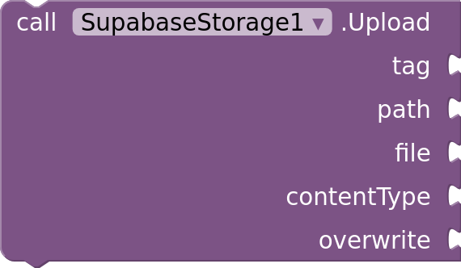

**Upload:** Uploads a file to a path in the bucket, such as photos/cat.jpg. File is a media file of the app (cat.jpg), a picker or camera result, an absolute path, or a path in the app's files. Leave contentType empty to guess it from the name. Uploaded fires when it's done.

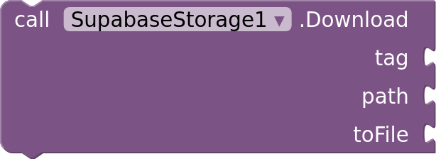

**Download:** Downloads a file from the bucket and saves it. ToFile is where to save it: a path in the app's files, or an absolute path. Downloaded fires with the saved file's full path.

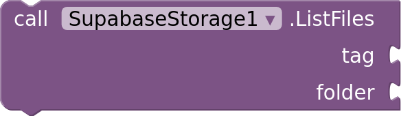

**ListFiles:** Lists the files and folders in a folder of the bucket. Leave folder empty for the top level. GotFiles fires with a list of dictionaries, one per file.

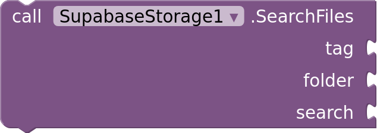

**SearchFiles:** Lists the files of a folder that match the search. Search is a dictionary with SearchField keys, all optional. GotFiles fires.

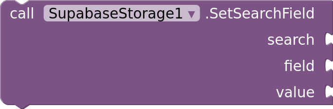

**SetSearchField:** Sets one setting of a search for SearchFiles, and checks its value.

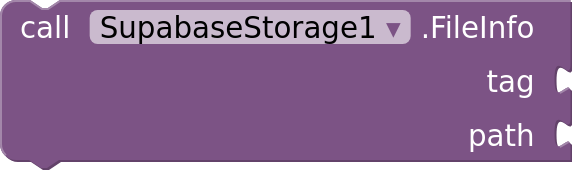

**FileInfo:** Gets a file's details, such as its size, content type and when it changed. GotFileInfo fires.

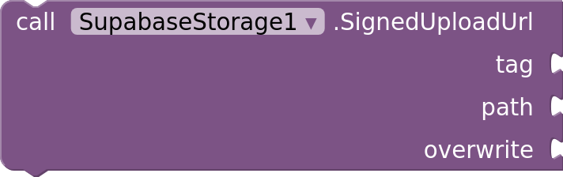

**SignedUploadUrl:** Makes a link that lets anyone upload one file to the path for the next two hours, even without access to the bucket. GotSignedUploadUrl fires with the link and its token; UploadWithToken uploads with the token.

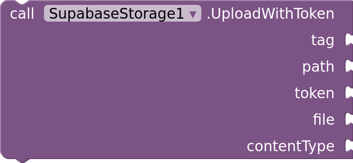

**UploadWithToken:** Uploads a file with a token from SignedUploadUrl, usually made by an Edge Function for a path the user can't write to. File and contentType work like in Upload. Uploaded fires.

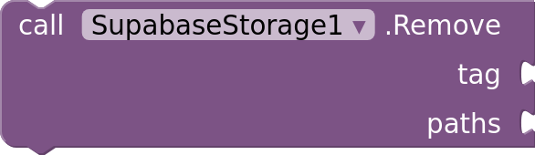

**Remove:** Deletes files from the bucket. Paths is a list of paths. Removed fires when they're gone.

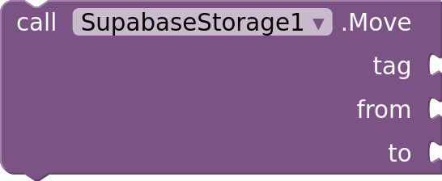

**Move:** Moves or renames a file in the bucket. Moved fires when it's done.

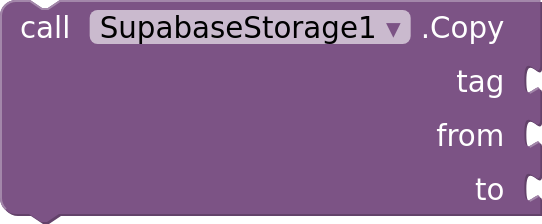

**Copy:** Copies a file within the bucket. Copied fires when it's done.

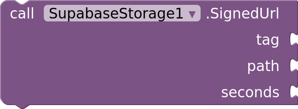

**SignedUrl:** Makes a link to a file that anyone can open for the given number of seconds, even in a private bucket. GotSignedUrl fires with the link.

**PublicUrl:** Returns the permanent link to a file in a public bucket. It works only if the bucket is public.

### SupabaseStorage: Events

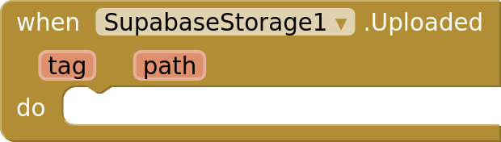

**Uploaded:** A file was uploaded.

**Downloaded:** A file was downloaded and saved. File is the saved file's full path, ready for an Image or Player.

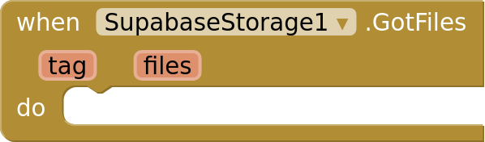

**GotFiles:** The files of a folder arrived from ListFiles.

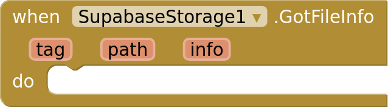

**GotFileInfo:** A file's details arrived from FileInfo, as a dictionary.

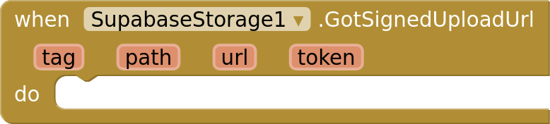

**GotSignedUploadUrl:** An upload link arrived from SignedUploadUrl. Token is what UploadWithToken needs.

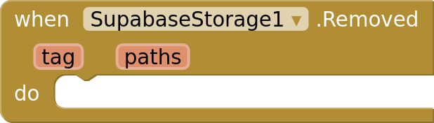

**Removed:** Files were deleted.

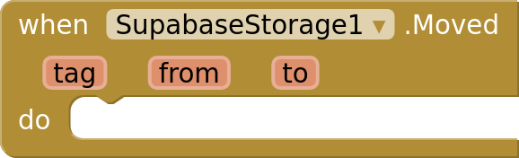

**Moved:** A file was moved.

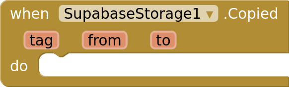

**Copied:** A file was copied.

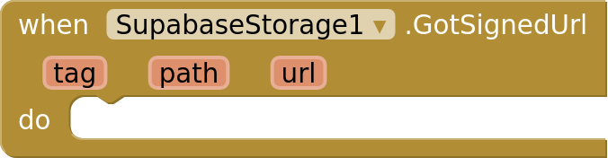

**GotSignedUrl:** A signed link arrived from SignedUrl.

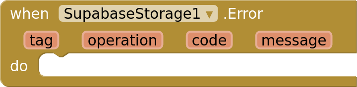

**Error:** A storage call failed. Code is Supabase's error code, or network. Without this event, Screen.ErrorOccurred fires instead.

### SupabaseStorage: Properties

 

**Client** (read-write): The Supabase component to use.

 

**Bucket** (read-write): The name of the bucket.

## SupabaseChannel

A realtime channel: receives database changes as they happen, and sends messages and online status between the users of the same channel. Guide: [Realtime](realtime.md).

### SupabaseChannel: Functions

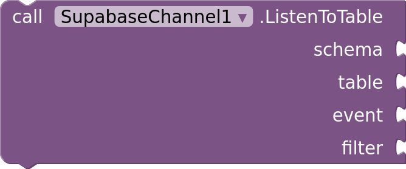

**ListenToTable:** Receives changes to a table through ChangeReceived. Call it before Subscribe. Filter is empty, or one filter from SupabaseDatabase's Filter block (Equals, NotEquals, GreaterThan, GreaterOrEqual, LessThan, LessOrEqual or In). Realtime must be enabled for the table, and row-level security decides which changes arrive.

**ListenToBroadcast:** Receives broadcasts with the given event name through BroadcastReceived. Call it before Subscribe.

**Subscribe:** Connects the channel. StatusChanged fires with Subscribed once it receives. Listeners added with ListenToTable and ListenToBroadcast stay, so Subscribe works again after Unsubscribe.

**Unsubscribe:** Disconnects the channel. StatusChanged fires with Unsubscribed.

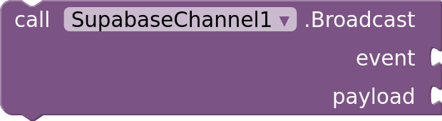

**Broadcast:** Sends a message to everyone subscribed to the channel. Payload is a dictionary.

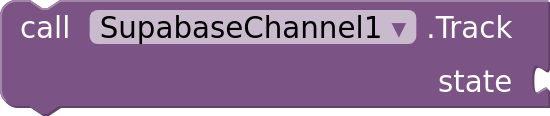

**Track:** Shares this app's state, such as a name or status, with everyone on the channel. PresenceChanged fires on every app, including this one.

**Untrack:** Stops sharing this app's state.

### SupabaseChannel: Events

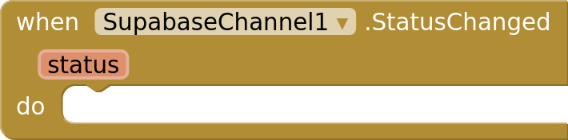

**StatusChanged:** The channel connected or disconnected.

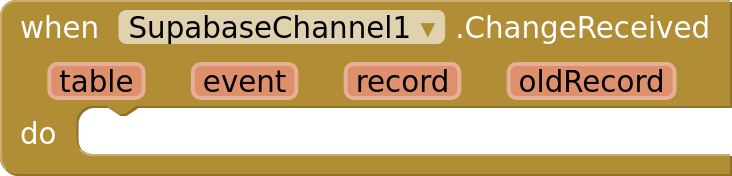

**ChangeReceived:** A row changed. Record is the row after the change, and oldRecord the row before it (for Update and Delete; it has only the primary key unless the table's replica identity is full).

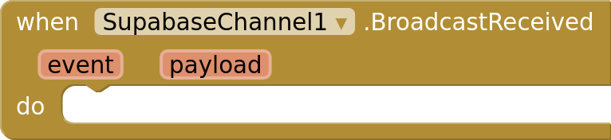

**BroadcastReceived:** A broadcast arrived. Payload is usually a dictionary.

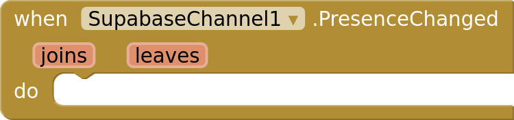

**PresenceChanged:** Users joined or left the channel, or changed their tracked state. Joins and leaves are dictionaries from presence key to state.

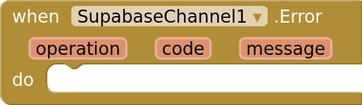

**Error:** A channel call failed. Without this event, Screen.ErrorOccurred fires instead.

### SupabaseChannel: Properties

 

**Client** (read-write): The Supabase component to use.

 

**Topic** (read-write): The channel's name. Users on the same topic share broadcasts and presence.

 

**ReceiveOwnBroadcasts** (read-write): Whether BroadcastReceived also fires for this app's own broadcasts.

 

**PresenceKey** (read-write): The name this app's presence is tracked under, such as the user's id. Leave empty for a random one.

 

**Private** (read-write): Whether only users allowed by the project's policies on realtime.messages may join the channel, send broadcasts and track presence. Set it before Subscribe.

**IsSubscribed** (read-only): Whether the channel is subscribed.

**PresenceState** (read-only): Everyone on the channel right now, as a dictionary from presence key to tracked state. Empty until the channel is subscribed.

## SupabaseFunctions

Calls the Edge Functions of a Supabase project: server code that runs with the signed-in user's identity, for work an app can't do on its own, like calling paid APIs with secret keys. Guide: [Edge Functions](functions.md).

### SupabaseFunctions: Functions

**Invoke:** Calls an Edge Function. Body is a dictionary or list (sent as JSON), text, or empty for none. Headers is a dictionary of extra HTTP headers. GotResponse fires with the response; a JSON response arrives as a dictionary or list.

### SupabaseFunctions: Events

**GotResponse:** An Edge Function answered. Status is the HTTP status code.

**Error:** A function call failed, or the function answered with an error status. Code is http_ and the status, such as http_404, or network. Without this event, Screen.ErrorOccurred fires instead.

### SupabaseFunctions: Properties

 

**Client** (read-write): The Supabase component to use.

 

**Region** (read-write): Where functions run. Choose the region of your database when a function uses it a lot, so its queries are fast.

## Dropdowns

Choices for blocks, properties and the keys of query and search dictionaries.

**ChangeEvent:** All, Insert, Update, Delete

**ChannelStatus:** Subscribing, Subscribed, Unsubscribed

**FilterOperator:** Equals, NotEquals, GreaterThan, GreaterOrEqual, LessThan, LessOrEqual, Like, LikeIgnoreCase, Is, In, Contains, ContainedBy, Overlaps, TextSearch

**QueryField:** Columns, Filters, OrderBy, Limit, Offset

**Region:** Any, ApNortheast1, ApNortheast2, ApSouth1, ApSoutheast1, ApSoutheast2, CaCentral1, EuCentral1, EuWest1, EuWest2, EuWest3, SaEast1, UsEast1, UsWest1, UsWest2

**RequestMethod:** Post, Get, Put, Patch, Delete

**SearchField:** Search, SortBy, Limit, Offset

**SessionStatus:** SignedIn, SignedOut, RefreshFailed

## Deprecated

Hidden from the blocks drawer and kept working for existing projects. The guides name the blocks that replace them: `SupabaseDatabase.Select`.
